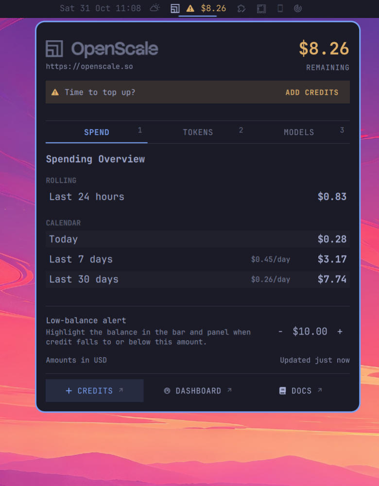

<!-- markdownlint-disable-file MD033 -->

<div align="center">
  
</div>

# OpenScale for Omarchy v4+

**Your OpenScale balance in the Omarchy bar with easy access to extended spending, token usage,
and model pricing information**

[OpenScale](https://openscale.so) provides open-source AI models at cheap prices for users in
emerging economies.

This plugin adds an [Omarchy](https://omarchy.org) top bar widget showing current account balance,
with a popup window displaying the **account balance** and what was spent **today**, the last seven
or 30 days. It also shows token usage, which models were used and available models and their usage rates.

<div align="center">
  
</div>

---

> [!NOTE]
> This project is not affiliated with or endorsed by OpenScale.

---

## Key Features

### Spending Overview (USD)

<div align="center">
  
</div>

<br />
<br />

- Provides a quick overview of the rolling spending within:
  - the **Last 24 hours**
  - **Today** (_resets at midnight_)
  - the **Last 7 days**
  - the **Last 30 days**
- Set a low-balance alert threshold; the default is $3.00.

<br />

### Tokens & Models Used

<div align="center">
  
</div>

<br />
<br />

- Easy overview of requests and token usage for:
  - **Today**
  - the **Last 7 days**
  - the **Last 30 days**
- One line per window under a pinned column header, with one unit per column so
  figures stay comparable down the list.
- Shows used models in an indented list with each one's share of the window's
  tokens.

<br />

### Available Models & Pricing

<div align="center">
  
</div>

<br />
<br />

- Shows available models grouped by vendor, cheapest-input first, with details showing:
  - Context window
  - Input, output, and cached-input prices per 1M tokens
  - A ⚡ mark for fast-serving variants
  - A **NEW** label beside recently added models
  - Tooltip with the full model name is shown on hover over model name
- Type in the filter field to narrow the list live; `Esc` clears it.

> [!Note]
> The model list is cached on disk for 24 hours. It appears immediately when you open the panel and
> refreshes when you visit the Models tab after the cache expires.

<br />

### Low Balance Notification

<div align="center">
  
</div>

<br />
<br />

- Amber warning glyph and figure in the bar and panel header when your balance
  is at or below your set limit; red no-entry glyph and figure once it hits zero.
- One desktop notification each time the balance crosses into the low state —
  normal urgency when low, critical at zero.
- An amber banner in the panel puts an ADD CREDITS button next to the warning,
  and the footer's Credits link is promoted to a filled button.
- The balance refreshes every 5 minutes by default, or when the panel is opened.

### Keyboard Navigation

- Switch tabs by pressing `1`, `2`, `3` or `←`, `→` or `h`, `l`
- Press `Esc` to close the panel
- Press `Tab` to move to the next bar panel.
- Footer links are keyboard-reachable: `Tab` to a button, `Enter` to open it.
- On the Tokens and Models lists, `PageUp` / `PageDown` / `Home` / `End` scroll
  once the list has focus (`Tab` moves focus there from the model filter).

> [!Note]
> While the model filter is focused, typing is captured by the field; `Esc`
> clears it and hands the keys back.

---

## Quick Start

To use the plugin you need to have **OpenScale CLI** installed and be signed in. See the
[OpenScale Dashboard](https://app.openscale.so/app) for the OpenScale CLI installation instructions.

Ensure you are logged in before installing the plugin:

```bash
osc login
```

Then install and enable the plugin:

```bash
omarchy plugin add https://github.com/kematzy/omarchy-plugin-openscale.git --enable
```

The widget appears in the right section of the bar, but you can easily move it by clicking and
dragging.

---

## Configuration

Three settings are available in Omarchy's **Settings → Widgets** panel and can also be edited from
the command line:

| Setting              | Default | What it does                                                    |
| -------------------- | ------- | --------------------------------------------------------------- |
| `lowBalance`         | `3`     | Highlight the balance at or below this many dollars.            |
| `refreshIntervalSec` | `300`   | Background refresh interval in seconds.                         |
| `openRefreshGapSec`  | `60`    | Refresh on panel open only if the last read is older than this. |

```bash
omarchy bar set io.github.kematzy.openscale lowBalance 10 --json
omarchy bar set io.github.kematzy.openscale refreshIntervalSec 120 --json
```

## Privacy & Security

- **Runs unsandboxed**

  Like other Omarchy plugins, this plugin runs inside `omarchy-shell` without a sandbox and with
  your user account's privileges. Review the code before enabling it.

- **Read-only account access**

  The plugin uses the CLI to read your balance, usage, and model catalogue. It does not create,
  rotate, or revoke API keys, move credit, or write to your OpenScale account.

- **Credentials stay with the CLI**

  The plugin does not read, copy, log, or cache your token or API key. `osc` manages device login;
  the widget only requests data through the CLI.

- **Local persistent data**

  The model listing cache is stored in `~/.cache/omarchy/openscale/`, and the low-balance threshold
  is saved to your bar configuration through `omarchy bar set`.

- **OpenScale data access**

  The plugin does not make OpenScale API requests itself; it reads account data through the
  signed-in `osc` CLI. Clicking **Credits**, **Dashboard**, or **Docs** opens an OpenScale page in
  your browser.

- **Fixed commands**

  The plugin starts commands with fixed arguments, such as `osc balance --json`, `models.sh --read`,
  and `omarchy bar set …`. Values you type are not interpolated into shell commands.

- **No elevated privileges**

  The plugin does not request elevated permissions.

- **Visible errors**

  If a read fails, the last successful balance remains visible and the error is shown in the
  tooltip or the tab's footer.

The plugin runs inside `omarchy-shell`, like other bar widgets. To audit it before enabling,
start with `Service.qml`, `Usage.qml`, and `models.sh`.

## Updating & Removing

To update the plugin, run this command:

```bash
omarchy plugin update io.github.kematzy.openscale
```

To remove the plugin, run this command:

```bash
omarchy plugin remove io.github.kematzy.openscale
```

> [!Note]
> Removing the plugin leaves `~/.cache/omarchy/openscale/models.json` behind. It is harmless and safe
> to delete with:
>
> ```bash
> rm -rf ~/.cache/omarchy/openscale
> ```

## Contributing

Issues and pull requests are welcome. Before opening a PR, validate the plugin:

```bash
omarchy plugin validate .
```

If you have the shell's QML kit on disk, run the lint described in [docs/README.md](docs/README.md#checks).
Keep changes focused and follow the surrounding code style.

## License

Released under the [MIT](LICENSE).

Copyright [Kematzy](https://github.com/kematzy)

## Credits

- [**OpenScale**](https://openscale.so) — the models, API, and `osc` CLI this plugin uses.
  Most of the plugin code was created using OpenScale models for assistance.
- **Trademark** — the OpenScale name, logo, and wordmark are used in this plugin with
  OpenScale's permission.

- [**Omarchy**](https://omarchy.org) — the desktop, its shell, and the `qs.Ui` component kit used
  to build the panel.

- [**Omarchy plugin authors**](https://plugins.omarchy.org/) — many Omarchy plugins have served as
  useful references for this plugin.

## Technical documentation

For architecture, data sources, refresh and caching policies, Omarchy plugin mechanics, and
development notes, see **[docs/README.md](docs/README.md)**.
