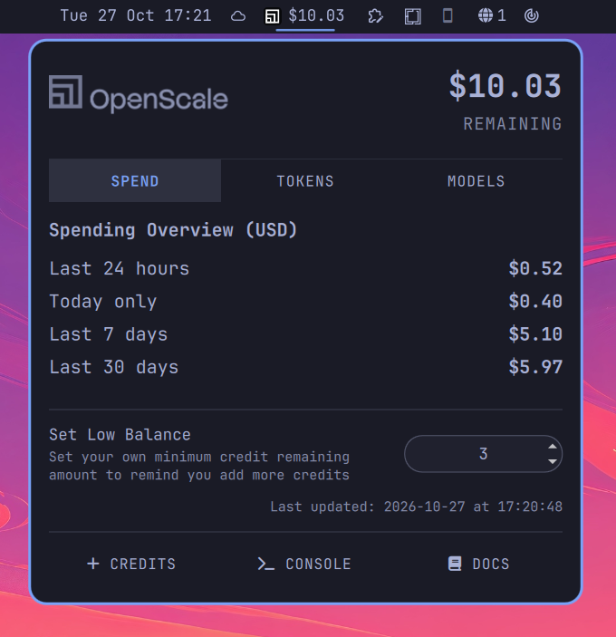
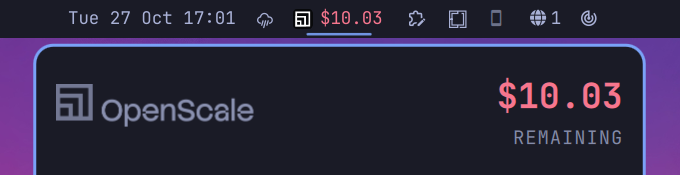
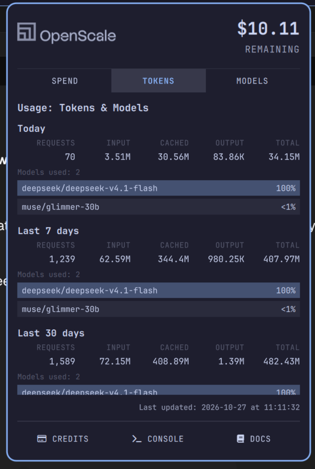
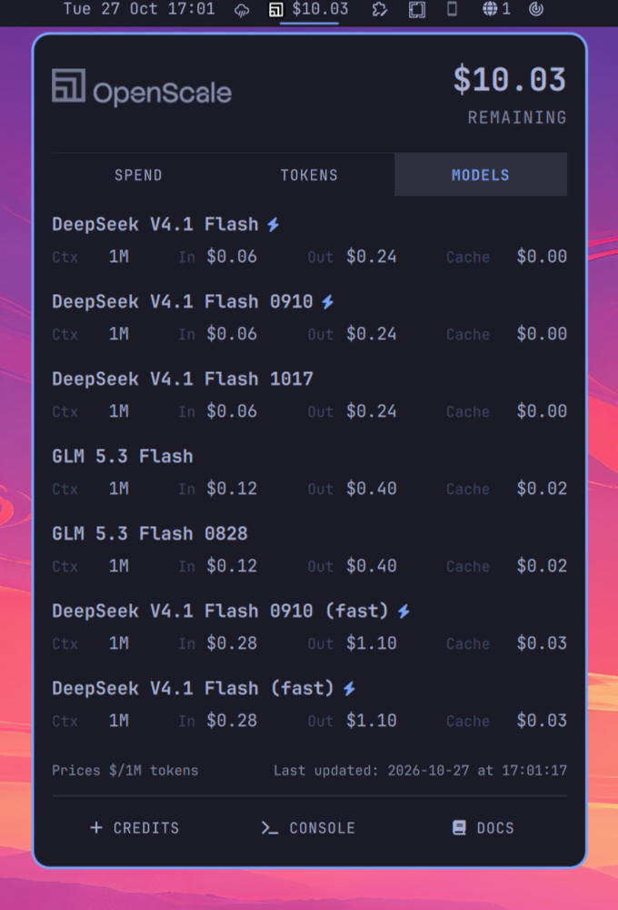

# OpenScale for Omarchy

**Your OpenScale credit, live in the Omarchy bar — with the spend, the token usage
and the model catalogue one click away.**



OpenScale serves open models through an OpenAI/Anthropic-compatible API. This
plugin puts the only number you actually watch — how much credit is left — where
you already look a hundred times a day, and keeps the details behind it a click
away instead of a browser tab away.

Everything comes from OpenScale's own signed-in CLI (`osc`). There is no API key
to paste, no token to store, and nothing to keep in sync.

## What it gives you

### In the bar

- The balance, next to the OpenScale mark: `$11.20`.
- It turns **urgent** when your credit drops to or below a threshold you set
  (default `$3.00`).
- Hover for the balance and, if a refresh failed, why.
- Click to open the panel; it refreshes the figure as it opens.
- Refreshes itself every 5 minutes in the background, so a glance is never far
  off — and immediately when you open the panel, if the last read is older than a
  minute.



*Once the balance reaches your threshold the figure turns urgent, here and in
the panel header, so a low balance is hard to miss.*

### Spend tab

The money, across four windows that answer different questions:

| Window            | What it is                                       |
| ----------------- | ------------------------------------------------ |
| **Last 24 hours** | rolling spend, straight from the account balance |
| **Today only**    | the calendar day so far                          |
| **Last 7 days**   | the rolling week                                 |
| **Last 30 days**  | the rolling month                                |

`Last 24 hours` and `Today only` are deliberately different numbers: one rolls,
one resets at midnight.

Below them, the **low balance alert** — the threshold that makes the bar and the
panel figure go urgent. Edit it in place; it is saved to your bar configuration.

### Tokens tab

Requests and tokens for today, the last 7 days and the last 30 days: requests,
input, cached input, output and their total. Under each window, the share of
tokens each model accounted for, as proportional bars — which tells you what is
actually doing the work.

### Models tab

Every model on offer, cheapest input first, with what you need to choose one:

- context window
- price per 1M tokens for input, output and cached input
- a ⚡ mark for fast-serving variants
- **NEW** against anything that appeared since the copy you had cached

The catalogue is cached on disk, so the tab is populated the instant the panel
opens and refreshes only when you look at it.

### Keyboard

`1` `2` `3` jump to a tab · `←` `→` (or `h` `l`) move between them · `Esc`
closes · `Tab` moves to the neighbouring bar panel. The threshold field on the
Spend tab takes over the arrow keys and digits while it has focus, so typing
`10` does not jump to tab 1.

## Screenshots

| Spend                           | Tokens                            | Models                            |
| ------------------------------- | --------------------------------- | --------------------------------- |
|  |  |  |

## Requirements

- **[Omarchy](https://omarchy.org/)** with `omarchy-shell` — the plugin targets its
  bar widget and panel API.
- **The OpenScale CLI, signed in.** The plugin reads everything through it.

  ```bash
  curl -fsSL https://openscale.so/install | sh
  osc login
  ```

- **`jq`**, used by the model-cache helper. Omarchy ships with it; on a bare
  Arch install, `omarchy pkg add jq`.

## Install

```bash
omarchy plugin add https://github.com/kematzy/omarchy-plugin-openscale.git --enable
omarchy restart shell
```

The widget lands in the right section of the bar. Move it with `omarchy bar move`
if you want it elsewhere.

By hand instead:

```bash
git clone https://github.com/kematzy/omarchy-plugin-openscale.git \
  ~/.config/omarchy/plugins/io.github.kematzy.openscale
omarchy plugin enable io.github.kematzy.openscale
omarchy restart shell
```

The folder name must equal the manifest id, which is why the clone goes to that
path.

## Configuration

Three settings, all live in your bar configuration and all editable from
Omarchy's own **Settings → Widgets** panel:

| Setting              | Default | What it does                                                                                             |
| -------------------- | ------- | -------------------------------------------------------------------------------------------------------- |
| `lowBalance`         | `3`     | Turn the figure urgent at or below this many dollars. Also editable on the Spend tab                     |
| `refreshIntervalSec` | `300`   | How often the balance is re-read in the background, 30 s minimum                                         |
| `openRefreshGapSec`  | `60`    | Opening the panel re-reads the balance only if the last read is older than this. `0` reads on every open |

```bash
omarchy bar set io.github.kematzy.openscale lowBalance 10 --json
omarchy bar set io.github.kematzy.openscale refreshIntervalSec 120 --json
```

## Privacy and safety

A credit widget has no business touching your account, so this one doesn't:

- **Read-only.** The only OpenScale operations are the CLI's own `balance`,
  `usage` and `models` reads. The plugin never creates, rotates or revokes a key,
  never moves credit, and never writes to your account.
- **Your credentials stay the CLI's.** The plugin never reads, copies, logs or
  caches a token or API key. `osc` owns the device login; the widget just asks it
  questions.
- **Only two things are ever written**, both local: a cache of the public model
  catalogue in `~/.cache/omarchy/openscale/`, and — when you edit it — the
  low-balance value in your own bar configuration, through `omarchy bar set`.
- **No hidden network calls.** The plugin speaks to nothing directly; all
  traffic is the `osc` CLI talking to OpenScale.
- **Fixed commands only.** Every process it starts uses a constant argv
  (`osc balance --json`, `models.sh --read`, `omarchy bar set …`, `xdg-open
  <link>`); nothing you type is interpolated into a shell command.
- **No stored secrets, no elevated privileges**, and no writes outside your home
  directory. The catalogue cache is public data — ids, limits, list prices.
- **It fails visibly.** A failed read keeps the last good figure on screen and
  says why in the tooltip or the tab's footer line, rather than blanking out.

The plugin runs inside `omarchy-shell`, as all bar widgets do. If you want to
audit it before enabling, the whole thing is a dozen QML files plus one shell
script — start with `Service.qml`, `Usage.qml` and `models.sh`.

## Updating and removing

```bash
omarchy plugin update io.github.kematzy.openscale
omarchy plugin remove io.github.kematzy.openscale
```

Removing the plugin leaves `~/.cache/omarchy/openscale/models.json` behind; it is
harmless and safe to delete:

```bash
rm -rf ~/.cache/omarchy/openscale
```

## Contributing

Issues and pull requests are welcome. Before opening a PR:

```bash
omarchy plugin validate .
```

and, if you have the shell's QML kit on disk, the lint described in
[docs/README.md](docs/README.md#checks). Keep changes focused and match the
surrounding style — the code is commented for a reason.

## Licence

[MIT](LICENSE).

## Credits

- **[OpenScale](https://openscale.so)** — the models, the API and the `osc` CLI
  this plugin is a window onto.
- **[Omarchy](https://omarchy.org)** — the desktop, its shell, and the `qs.Ui`
  component kit the panel is built from.
- **[Omarchy.OpenRouter](https://github.com/SpoilHeap/Omarchy.OpenRouter)** by
  SpoilHeap — the reference for what a bar widget with a popup should look like,
  and the source of several good ideas about handling a balance that comes from a
  CLI-ish source.

## Technical documentation

Architecture, data sources, refresh and caching policy, the Omarchy plugin
mechanics, and how to work on the code: **[docs/README.md](docs/README.md)**.
